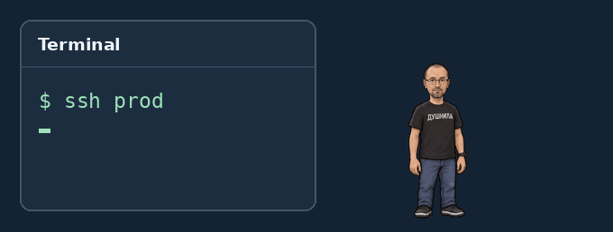

# Dushnila Pet

[Русский](README.md) · **English**

> “It works on my machine!”

Dushnila is a playful, interactive desktop assistant. Give him two monitors and he’ll make himself at home on both, hopping between screens and occasionally rearranging a couple of shortcuts. Start an SSH session and he puts on his hard hat. Open Google Chat and he stands beside it, hands in his pockets, with a comment of his own. When it’s time for a smoke break, he knocks on the glass.



## Downloads

| Platform | Build | Download |
| --- | --- | --- |
| Linux · GNOME Shell 46–50 | v13 | [GNOME archive](downloads/dushnila-desktop-v13.zip?raw=true) |
| Windows · x64 | v13-clickfix2 | [Windows executable](downloads/DushnilaPet-v13-clickfix2.exe?raw=true) |

[Release notes](CHANGELOG.md) · [SHA-256 checksums](downloads/SHA256SUMS)

## Linux

From the directory containing the downloaded archive, run these commands as your desktop user.

```bash
unzip dushnila-desktop-v13.zip
cd dushnila-desktop
bash install.sh
```

From a repository checkout, run `bash linux/install.sh` at the root instead. The installer adds a launcher named **Душнила** and a line to `~/.bashrc` so the pet can react to SSH in interactive Bash. If GNOME has yet to discover the extension, sign out, sign back in and open the launcher.

| Action | Control |
| --- | --- |
| Move the pet | Hold the left mouse button and drag |
| Hear the knock | Middle-click the idle pet |
| Open settings | Shift + right-click |
| Disable the extension | `gnome-extensions disable dushnila@desktop.local` |

To let him rearrange real desktop shortcuts, enable manual placement in Desktop Icons NG. Swapping requires two shortcuts with saved positions.

## Windows

Download the x64 executable and double-click it. The launcher needs the .NET Framework compiler at startup. Right-click the pet to open his menu. Preferences are stored in `%APPDATA%\DushnilaPet\settings.ini`. Desktop icon movement is disabled by default.

| Action | Control |
| --- | --- |
| Move the pet | Hold the left mouse button and drag |
| Hear the knock | Middle-click |
| Release the pointer | Ctrl + Alt + Shift + R |
| Quit | Ctrl + Alt + Shift + Q |

[GNOME extension source](linux/shell/) · [Windows application source](windows/DushnilaPet.cs)
