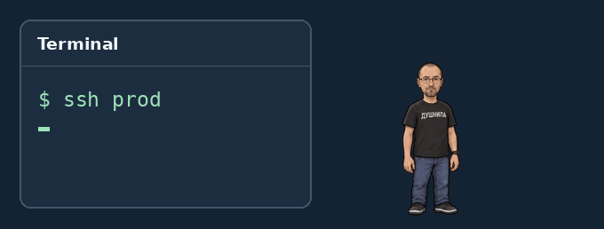

# Душнила Pet

**Русский** · [English](README.en.md)

> «У меня всё работает!»

Душнила — забавный интерактивный ассистент рабочего стола. На двух мониторах у него в распоряжении оба рабочих стола: дед перепрыгивает с одного экрана на другой и по пути может переставить пару ярлыков. Откроешь SSH — наденет каску. Заглянешь в Google Chat — встанет рядом, засунет руки в карманы и выдаст комментарий. А когда придёт время перекура, сам постучит в экран.



## Скачать

| Платформа | Сборка | Файл |
| --- | --- | --- |
| Linux · GNOME Shell 46–50 | v13 | [Архив для GNOME](downloads/dushnila-desktop-v13.zip?raw=true) |
| Windows · x64 | v13-clickfix2 | [Запускной EXE](downloads/DushnilaPet-v13-clickfix2.exe?raw=true) |

[Описание выпуска](CHANGELOG.md) · [Контрольные суммы SHA-256](downloads/SHA256SUMS)

## Linux

В каталоге со скачанным архивом выполни команды от своего пользователя.

```bash
unzip dushnila-desktop-v13.zip
cd dushnila-desktop
bash install.sh
```

При установке из клона репозитория выполни `bash linux/install.sh` в его корне. Установщик добавит ярлык «Душнила» и строку в `~/.bashrc`, чтобы питомец мог реагировать на SSH в интерактивном Bash. Если GNOME ещё не видит расширение, выйди из сеанса, войди снова и нажми ярлык.

| Действие | Управление |
| --- | --- |
| Передвинуть деда | Зажать ЛКМ и перетащить |
| Услышать стук сразу | Нажать колёсико на спокойном деде |
| Открыть настройки | Shift + ПКМ |
| Убрать с рабочего стола | `gnome-extensions disable dushnila@desktop.local` |

Для перестановки реальных ярлыков включи ручную расстановку в Desktop Icons NG. Для обмена нужны два ярлыка с сохранёнными позициями. [Подробности и другие сценки](linux/README.md).

## Windows

Скачай EXE для x64 и запусти двойным щелчком. Для сборки при запуске нужен компилятор .NET Framework. Щёлкни по деду правой кнопкой, чтобы открыть меню. Настройки сохраняются в `%APPDATA%\DushnilaPet\settings.ini`. Перемещение значков по умолчанию выключено.

| Действие | Управление |
| --- | --- |
| Передвинуть деда | Зажать ЛКМ и перетащить |
| Проверить стук | Нажать колёсико |
| Отпустить курсор | Ctrl + Alt + Shift + R |
| Выйти | Ctrl + Alt + Shift + Q |

[Исходник расширения GNOME](linux/shell/) · [Исходник приложения Windows](windows/DushnilaPet.cs)
